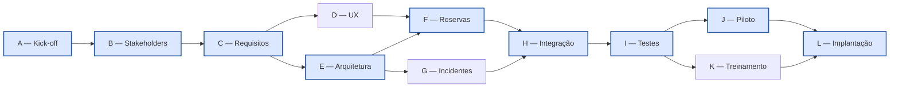

# LabFlow — Relatório técnico do Incremento 2

**Projeto Integrador Individual de Gerência de Projetos de Software**  
**Aluno:** Luiz Soares de Sousa Neto — **Matrícula:** 558546  
**Docente:** Fernanda Ester Pereira de Souza — **Turma:** CRT0266 — Turma 01  
**Data de referência:** 19/10/2026  
**Repositório:** https://github.com/LN599/TB_gerencia_marco_1  
**GitHub Projects (quadro utilizado no Incremento 1):** https://github.com/users/LN599/projects/1

> **Nota de transparência:** este incremento trata de **planejamento e simulação acadêmica**, não de software programado, contratações, gastos reais ou resultados medidos em produção. As datas de trabalho planejadas não devem ser confundidas com o histórico real das Issues do GitHub.

## 1. Continuidade do Incremento 1

O LabFlow é um sistema web responsivo para centralizar a gestão de reservas, aprovações, incidentes e indicadores de seis laboratórios acadêmicos, com aproximadamente 180 computadores, no cenário fictício utilizado anteriormente. Mantêm-se a abordagem **híbrida** (baseline preditiva com refinamentos incrementais), o conjunto de requisitos **RF01–RF12** e **RNF01–RNF08**, as histórias de usuário e a EAP/WBS concebidas no Marco 1.

O Business Case fixou **investimento inicial de R$ 38.000**, benefícios brutos anuais estimados de R$ 25.000, custos operacionais anuais de R$ 9.000, fluxo líquido anual de R$ 16.000, horizonte de quatro anos e TMA de 10% a.a. A estimativa anterior por Planning Poker foi de **60 Story Points**, com reserva de 15% (69 pontos como referência), não convertidos mecanicamente para horas.

## 2. Cronograma: PERT, PDM, CPM e baseline

As atividades A–L são as mesmas da rede PDM inicial. Para cada uma, **PERT = (O + 4M + P)/6**, com variância `((P − O)/6)²`. As relações são predominantemente **término–início (FS)**. O cronograma usa dias úteis, início planejado em **26/10/2026**, sem feriados nem nivelamento de recursos. **ES/EF** são início/término cedo; **LS/LF**, início/término tarde; folga = LS − ES.

| ID | Atividade | Antecessoras | O/M/P | te (dias) | ES | EF | Folga | Custo |
|---|---|---|---|---:|---:|---:|---:|---:|
| A | Kick-off e validação do Business Case | — | 1/2/3 | 2,00 | 0,00 | 2,00 | 0,00 | R$ 500,00 |
| B | Levantamento com stakeholders | A | 4/5/7 | 5,17 | 2,00 | 7,17 | 0,00 | R$ 1.500,00 |
| C | Especificação e validação de requisitos | B | 5/7/11 | 7,33 | 7,17 | 14,50 | 0,00 | R$ 2.500,00 |
| D | Protótipo UX | C | 4/6/10 | 6,33 | 14,50 | 20,83 | 1,00 | R$ 1.500,00 |
| E | Arquitetura e dados | C | 5/7/11 | 7,33 | 14,50 | 21,83 | 0,00 | R$ 3.500,00 |
| F | Módulo de reservas | D, E | 12/16/22 | 16,33 | 21,83 | 38,17 | 0,00 | R$ 8.000,00 |
| G | Módulo de incidentes | E | 9/13/19 | 13,33 | 21,83 | 35,17 | 3,00 | R$ 4.500,00 |
| H | Integração e notificações | F, G | 4/6/10 | 6,33 | 38,17 | 44,50 | 0,00 | R$ 4.000,00 |
| I | Testes e homologação | H | 6/9/15 | 9,50 | 44,50 | 54,00 | 0,00 | R$ 4.000,00 |
| J | Piloto acadêmico | I | 4/6/8 | 6,00 | 54,00 | 60,00 | 0,00 | R$ 1.000,00 |
| K | Treinamento de usuários-chave | I | 3/5/9 | 5,33 | 54,00 | 59,33 | 0,67 | R$ 2.000,00 |
| L | Implantação inicial | J, K | 2/3/5 | 3,17 | 60,00 | 63,17 | 0,00 | R$ 1.000,00 |

**Caminho crítico:** A → B → C → E → F → H → I → J → L.  
**Duração esperada:** 63,17 dias úteis (planejamento de calendário: 64 dias úteis).  
**Término planejado:** 21/01/2027.  
**Folgas relevantes:** D = 1,00 dia; G = 3,00 dias; K = 0,67 dia.

**Dependências:** técnicas/obrigatórias (arquitetura antes dos módulos; testes antes do piloto), arbitradas (ordenação de UX) e externas (disponibilidade de turma/docentes no piloto e infraestrutura liberada na implantação). Atrasos sobre o caminho crítico afetam o término; folgas menores devem ser monitoradas para impedir sua transformação em atividades críticas.

| Marco | Data administrativa aproximada | Evidência de aceitação |
|---|---|---|
| M1 — Business Case e escopo | até 13/11/2026 | Requisitos e fronteiras validados (C) |
| M2 — Arquitetura e UX | até 25/11/2026 | E e D validados; F liberado |
| M3 — Integração | até 29/12/2026 | F, G e H integrados |
| M4 — Homologação e piloto | até 15/01/2027 | I, J e K validados |
| M5 — Implantação inicial | 21/01/2027 | Infraestrutura liberada e aceite institucional |

**Baseline simulada:** planejamento de cronograma fechado conceitualmente em 19/10/2026 com as precedências, estimativas e marcos acima. Os marcos são datas administrativas aproximadas; o CPM é a referência técnica. Uma revisão de prazo exige registro de desvio, análise de impacto e autorização do patrocinador quando necessária.

## 3. Estimativas de custos, orçamento e Curva S

A composição é **bottom-up**, agregada pelos grupos do Business Case do Marco 1. São valores assumidos academicamente para dedicação parcial de profissionais, não remunerações ou cotações.

| Grupo | Atividades | Valor |
|---|---|---:|
| Análise e UX | A–D | R$ 6.000,00 |
| Desenvolvimento | E–H | R$ 20.000,00 |
| Testes e homologação | I–J | R$ 5.000,00 |
| Treinamento e implantação | K–L | R$ 3.000,00 |
| **BAC (baseline de custos)** | **A–L** | **R$ 34.000,00** |
| Reserva de contingência | riscos conhecidos, fora do BAC | R$ 4.000,00 |
| **Orçamento do projeto** | | **R$ 38.000,00** |

A **Curva S (PV)** acumula os custos orçados das atividades de forma linear enquanto elas estão previstas para ocorrer, usando os intervalos ES–EF, por semana de cinco dias úteis. A contingência de R$ 4.000 não compõe o BAC nem o PV.

| Semana | PV acumulado | % BAC |
|---:|---:|---:|
| 1 | R$ 1.370,97 | 4,0% |
| 2 | R$ 2.965,91 | 8,7% |
| 3 | R$ 4.857,06 | 14,3% |
| 4 | R$ 8.427,63 | 24,8% |
| 5 | R$ 12.119,77 | 35,6% |
| 6 | R$ 16.256,25 | 47,8% |
| 7 | R$ 20.392,73 | 60,0% |
| 8 | R$ 23.157,89 | 68,1% |
| 9 | R$ 26.210,53 | 77,1% |
| 10 | R$ 28.315,79 | 83,3% |
| 11 | R$ 30.541,67 | 89,8% |
| 12 | R$ 33.000,00 | 97,1% |
| 13 | R$ 34.000,00 | 100,0% |

## 4. Monitoramento: cenário pedagógico de Valor Agregado

**Corte simulado:** final da semana 6. Foram assumidos **EV = R$ 14.500,00** e **AC = R$ 16.500,00**; o **PV = R$ 16.256,25** é retirado da Curva S.

| Indicador | Fórmula | Resultado |
|---|---|---:|
| BAC | Soma orçada A–L | R$ 34.000,00 |
| PV | Planejado ao final da semana 6 | R$ 16.256,25 |
| EV | Valor do trabalho aceito (simulação) | R$ 14.500,00 |
| AC | Custo realizado (simulação) | R$ 16.500,00 |
| SV | EV − PV | R$ -1.756,25 |
| CV | EV − AC | -R$ 2.000,00 |
| SPI | EV / PV | 0,892 |
| CPI | EV / AC | 0,879 |
| EAC | BAC / CPI | R$ 38.689,66 |
| ETC | EAC − AC | R$ 22.189,66 |
| VAC | BAC − EAC | R$ -4.689,66 |
| TCPI para BAC | (BAC − EV)/(BAC − AC) | 1,114 |

**Interpretação gerencial:** SPI < 1 aponta atraso frente à baseline; CPI < 1 significa eficiência de custo abaixo do planejado. Se a tendência de CPI persistir, o EAC (R$ 38.689,66) supera o orçamento total de R$ 38.000 em **R$ 689,66**. O TCPI acima de 1 exige elevação da eficiência futura. A decisão recomendada é investigar causas de retrabalho e gargalos, rever prioridades sem comprometer segurança/qualidade e submeter eventual necessidade de ajuste à aprovação do Sponsor. Alterar o BAC para melhorar o CPI seria incorreto.

## 5. Qualidade: ISO/IEC 25010, métricas, aceite e PDCA

| Característica relevante | Critério / métrica de aceite | Forma de verificação |
|---|---|---|
| Adequação funcional | 100% dos fluxos críticos aprovados, sem dupla reserva no mesmo laboratório/horário | Testes funcionais e homologação em I |
| Eficiência de desempenho (RNF03) | Resposta de consultas comuns ≤2 segundos no percentil 95 (P95) | Teste de carga em I |
| Confiabilidade (RNF02/RNF06) | Disponibilidade-meta de 99,5%/mês; backup diário, retenção ≥30 dias | Monitoramento no piloto e teste de restauração |
| Usabilidade (RNF01/RNF08) | Solicitação por usuário treinado em até 3 minutos; interface responsiva | Testes com docentes em D e J |
| Segurança (RNF04/RNF05/RNF07) | Nenhuma falha crítica aberta, controle por perfil, operações auditáveis e revisão LGPD | Inspeção de permissões e testes em I |
| Rastreabilidade de operação | 100% das reservas com histórico; ≥95% de incidentes registrados após entrada em operação | Verificação de logs e indicadores |

**PDCA:** **Plan** (planejar métricas e casos de teste) → **Do** (executar inspeções/testes) → **Check** (comparar resultados e registrar não conformidades) → **Act** (corrigir causas, aplicar regressão e registrar lições aprendidas).

**Prevenção:** revisão de requisitos, protótipos e critérios de aceite antes da construção; **correção:** defeitos documentados, responsáveis, gravidade, ajustes e reteste. Aceite de negócio é realizado pelo Sponsor em conjunto com a coordenação.

## 6. Planejamento de equipe e recursos

A equipe é **fictícia**, organizada em estrutura matricial balanceada e com dedicação parcial. Não se presume implementação real.

| Papel | Quantidade | Responsabilidade |
|---|---:|---|
| Gerente de Projetos | 1 | Integração, baseline, orçamento, comunicação, decisões e riscos |
| Desenvolvedores full-stack | 2 | Arquitetura, módulos, integrações e correções |
| QA/testes | 1 | Critérios de qualidade, testes, homologação e evidências |
| UX/UI designer | 1 | Fluxos, protótipo, acessibilidade e feedback |
| DevOps/infraestrutura | 1 | Ambientes, backup, controle técnico e implantação |
| **Total da equipe-base** | **6** | |

Modelo de Tuckman: **forming**, **storming**, **norming**, **performing** e **adjourning** esperados no ciclo de vida; não são estágios empiricamente observados aqui. O modelo de Belbin não foi aplicado por ausência de avaliação de perfis.

## 7. Plano de comunicação

| Stakeholder | Informação | Responsável | Canal | Periodicidade |
|---|---|---|---|---|
| Sponsor / direção | Prazo, orçamento, riscos altos e aprovações | Gerente de Projetos | Reunião de marco e ata | Quinzenal e por exceção |
| Coordenação de laboratórios | Regras de reserva, protótipo e homologação | GP + UX | Reunião e GitHub Issue | Semanal |
| Equipe técnica (6) | Bloqueios, andamento, responsáveis e testes | GP e responsáveis técnicos | GitHub Projects e reunião | Duas vezes por semana |
| QA / UX | Critérios de aceite, defeitos e feedback | GP | Issues e documentação | A cada entrega ou validação |
| Docentes representantes | Fluxos, disponibilidade e piloto | UX + coordenação | Demonstração e formulário | Nas validações D e J |
| Suporte de TI / DevOps | Infraestrutura, permissões, backup e piloto | DevOps | Issues e reunião técnica | Semanal e por marco |
| Segurança / LGPD | Dados pessoais, acessos e auditoria | GP + DevOps | Checklist e parecer | Antes da homologação |
| Estudantes / usuários | Orientações para piloto e implantação | Coordenação | Comunicado institucional | Antes do piloto |

Para **n=6**, são **n(n−1)/2 = 15 canais potenciais**; se a equipe passar a **n=8**, serão 28 canais, crescimento de 86,7%. Isso justifica informação padronizada em atas/Issues, atribuição clara e escalonamento tempestivo de impedimentos. Informações relevantes de escopo, prazo, custo e aceite ficam registradas; riscos elevados são escalados ao GP no mesmo dia e ao Sponsor conforme impacto.

## 8. Riscos: Risk Register, RBS, matriz e Ishikawa

Escala **P e I de 1 a 5**, pontuação **P×I**; **alta ≥15**, **média 8–14**, **baixa ≤7**. As probabilidades são avaliações qualitativas para planejamento, não frequências reais.

| ID | Risco | Categoria RBS | P | I | P×I | Classe | Responsável |
|---|---|---|---:|---:|---:|---|---|
| R01 | Regras de reserva inconsistentes | Requisitos / processo | 4 | 5 | 20 | Alta | GP / coordenação |
| R02 | Ambiente instável / indisponível | Tecnologia | 3 | 4 | 12 | Média | DevOps |
| R03 | Baixa adesão de docentes | Organização / pessoas | 4 | 4 | 16 | Alta | UX / coordenação |
| R04 | Falhas de privacidade / controle | Segurança | 3 | 5 | 15 | Alta | DevOps / QA |
| R05 | Integração ou e-mail indisponível | Terceiros | 3 | 3 | 9 | Média | Desenvolvedor |
| R06 | Indisponibilidade de especialistas | Recursos | 3 | 4 | 12 | Média | GP |
| R07 | Crescimento não controlado do escopo | Gestão | 4 | 4 | 16 | Alta | GP / Sponsor |
| R08 | Sem janela para piloto acadêmico | Externo / calendário | 4 | 3 | 12 | Média | Coordenação |

**RBS (estrutura analítica de riscos):**
- **Técnicos:** tecnologia/ambientes (R02), segurança (R04), integrações e dependência de terceiros (R05).
- **Organizacionais/pessoas:** adesão (R03), profissionais disponíveis (R06).
- **Gestão:** requisitos/processos (R01) e expansão de escopo (R07).
- **Externos:** calendário e disponibilidade de turma (R08).

**Matriz qualitativa P×I:** riscos R01 (20), R03 (16), R07 (16) e R04 (15) são de prioridade alta; demais são de média prioridade. Avaliar exposição não equivale a executar a resposta: **evitar/mitigar/transferir/aceitar**, responsáveis, gatilhos e monitoramento detalhado pertencem ao Incremento 3.

**Ishikawa do problema “reservas duplicadas/conflitantes” (risco R01):**
- Pessoas: ausência de orientação, preenchimento informal e comunicação paralela.
- Processo: autorizações sem critério único e cancelamento não comunicado.
- Sistema/tecnologia: validação insuficiente de conflitos, concorrência entre solicitações.
- Dados: cadastro de horários e laboratórios desatualizado.
- Gestão: responsáveis indefinidos e falta de indicadores.

**Causa-raiz prioritária a verificar no planejamento:** ausência de uma regra única de disponibilidade e validação transacional antes da confirmação. A hipótese deve ser validada em especificação/testes; não é conclusão de incidente real.

## 9. Governança e evidências de GitHub Projects

O Incremento 2 prevê Issues vinculadas a tarefas de cronograma, custos, EVM, qualidade, recursos, comunicação e riscos. Cada Issue deve ter responsável, prioridade, status e marco de entrega coerentes com sua situação real. Um CSV de preparação está disponível em [dados/Incremento2_Issues.csv](../dados/Incremento2_Issues.csv), e os registros principais estão em [cronograma](../dados/Incremento2_Cronograma.csv), [riscos](../dados/Incremento2_Riscos.csv) e [comunicação](../dados/Incremento2_Comunicacao.csv).

**Importante:** o quadro está vinculado no documento porque consta no Incremento 1. A existência do link não prova que a docente tenha acesso nem que as Issues tenham sido vinculadas ao quadro. É necessário verificar essas permissões e relações no próprio GitHub.

## 10. Síntese

O cronograma simulado tem **63,17 dias úteis** de trabalho esperado, com caminho crítico A–B–C–E–F–H–I–J–L e término administrativo planejado em 21/01/2027. O orçamento original de R$ 38.000 é mantido (**BAC 34 mil + contingência 4 mil**). O cenário de valor agregado demonstra exposição potencial a atraso e sobrecusto; os planos de qualidade, equipe, comunicação e riscos tornam a governança operacionalizável. Estes são **artefatos de gestão**, não uma comprovação de desenvolvimento do LabFlow.

**Referências metodológicas:** Project Management Institute, *PMBOK Guide* (7ª ed., 2021); ISO/IEC 25010 (modelo de qualidade); métodos PERT, CPM, PDM, EVM e PDCA como estudados na disciplina.
